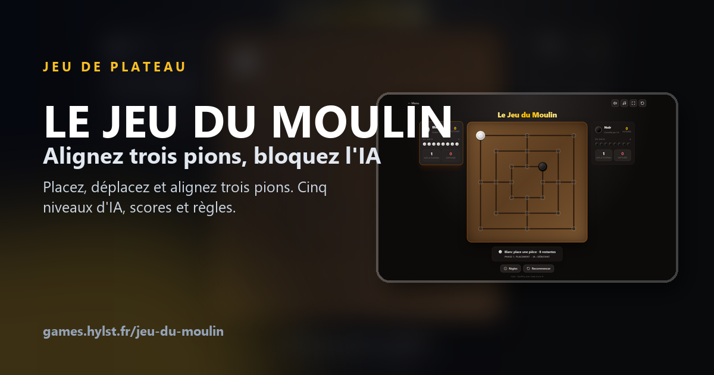

# Le Jeu du Moulin

**Le classique de stratégie, cinq niveaux d'IA et un mode deux joueurs.**

Le Jeu du Moulin se joue en trois phases : placement, déplacement, puis vol quand il ne reste que trois pions. Alignez trois pions sur une ligne pour retirer une pièce adverse, bloquez l'adversaire et ramenez-le à moins de trois pions. Cinq niveaux d'IA, du hasard au minimax profond 5, mode deux joueurs, scores et règles. Le plateau et les pièces sont dessinés en SVG, les sons sont synthétisés dans le navigateur.

Joue ici : [games.hylst.fr/jeu-du-moulin/](https://games.hylst.fr/jeu-du-moulin/)



## Fonctionnalités

- Cinq niveaux d'IA, du hasard au minimax profond 5.
- Mode deux joueurs sur le même écran.
- Trois phases : placement, déplacement, vol.
- Scores, pièces en main, pièces sur le plateau et pièces capturées.
- Règles intégrées, sons Web Audio et plein écran.
- Aucune donnée locale, aucun compte, aucun cookie.

## Technique

- React 19, TypeScript, Vite 7 et Tailwind CSS 4.
- Build en un fichier `index.html`.
- Plateau SVG, aucune image externe.

```bash
npm ci
npm run build
```

Le build sort dans `dist/`. Il se sert sous `/jeu-du-moulin/`.

## Structure

```
src/App.tsx                 écran, phases, scores et règles
src/ai/nineMensMorrisAI.ts  IA et minimax
src/audio/sounds.ts         sons Web Audio
src/styles/animations.css   animations du plateau
```

## Licence

AGPL-3.0-or-later. Voir `LICENSE`.

Jeu créé par Geoffroy (Hylst) avec l'aide d'une IA.
